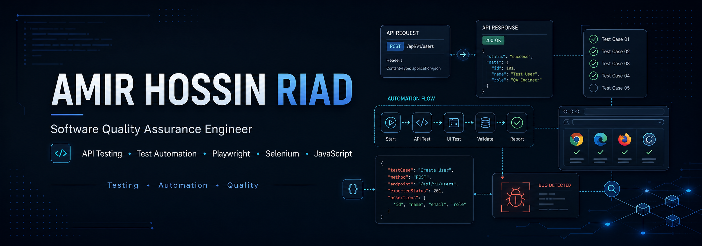
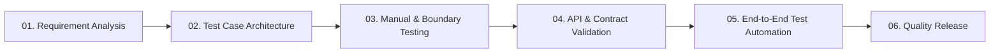

<div align="center">
  
</div>

<div align="center">

# AMIR HOSSIN RIAD

<!-- Animated Typing Terminal -->
<a href="https://github.com/amir2601">
  
</a>

<br><br>

[](https://www.linkedin.com/in/amir-hossin-riad/)
[](https://github.com/amir2601)

</div>

---

### // SYSTEM OVERVIEW

```yaml
[SYSTEM_TELEMETRY]
OPERATOR     : Amir Hossin Riad
ROLE         : Junior SQA Engineer
CORE_PIPELINE: Software Development >> SQA >> Test Automation
CURRENT_FOCUS: Manual Testing | API Testing | Test Automation
DIRECTIVE    : Deconstruct architectures, isolate edge cases, guarantee resilience.
```

I am transitioning a software development background into **Software Quality Assurance**, bridging the gap between engineering and quality verification. By analyzing applications from both the builder's and tester's perspectives, I design high-coverage test architectures that catch defects before they reach production.

---

### // QUALITY ASSURANCE LIFECYCLE



---

### // TECH STACK & TOOLCHAIN

#### [01] QA & TEST AUTOMATION
<p align="left">
  
  
  
  
</p>

#### [02] PROGRAMMING & RUNTIMES
<p align="left">
  
  
</p>

#### [03] ENVIRONMENT & TOOLING
<p align="left">
  
  
  
</p>

---

### // FEATURED REPOSITORY

#### Postman API Automation Suite
> Scalable API validation framework and automated assertion practice.

* **Payload & Status Verification:** Deep inspection of HTTP responses and header contracts.
* **JSON Schema Enforcement:** Automated verification of JSON payloads against strict models.
* **Dynamic Test Environments:** Execution leveraging collection variables and real-time generation.
* **End-to-End Workflow Execution:** Multi-step transactional chains validating full order lifecycles.

[](https://github.com/amir2601/postman-api-automation)

---

### // CAPABILITY MATRIX

| Core Domain | Stack & Methodologies | Pipeline Status |
| :--- | :--- | :--- |
| **API Verification** | Postman, REST API Testing, Schema Validation | `DEPLOYED` |
| **Test Automation** | Playwright, Selenium WebDriver, JavaScript | `ACTIVE` |
| **Quality Strategy** | Test Case Design, Boundary Value Analysis, Equivalence Partitioning | `DEPLOYED` |
| **Lifecycle Analysis**| STLC, SDLC, Defect Tracking & Root Cause Analysis | `DEPLOYED` |

---

### // CAREER TRAJECTORY

```text
+--------------------------------+
| Software Engineering Foundation |
+--------------------------------+
                |
                v
+--------------------------------+
| Manual Testing & Test Design   |
+--------------------------------+
                |
                v
+--------------------------------+
| API Contract & Workflow Testing|
+--------------------------------+
                |
                v
+--------------------------------+
| Automated Testing Frameworks   |
+--------------------------------+
                |
                v
+--------------------------------+
| Junior SQA Engineer            |
+--------------------------------+
```

---

### // TELEMETRY & ACTIVITY

<div align="center">


<br>


</div>

---

<div align="center">

#### SYSTEMS BUILT. DEFECTS IDENTIFIED. RESILIENCE VERIFIED.


</div>
